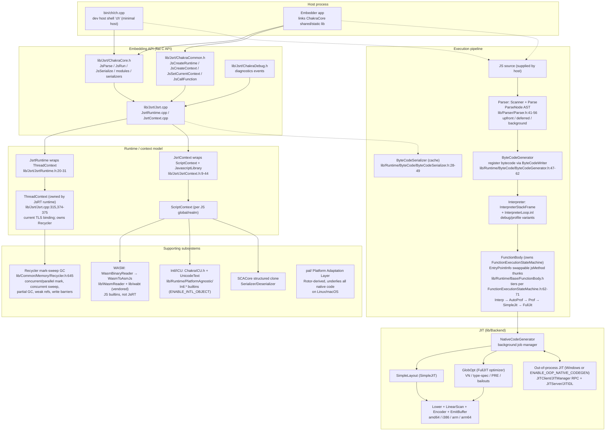

# ChakraCore Architecture

> Engine version: 1.13.0 dev (`lib/Common/ChakraCoreVersion.h:19-21`, `RELEASE 0`).
> Community-maintained, embedded-focused since Microsoft ended 1.11 security updates
> in March 2021 (`README.md:9-16`). Originally pinned to upstream HEAD
> `97e68c917`; the `modernize/baseline` branch has since advanced well past
> it (current state: `modernization-plan.md` §6) without changing the
> layering described here.
> There is no `src/` directory; engine source lives in `lib/`.

## Overview diagram

Notes on the diagram: the host supplies source text into the parser (dotted edges);
the `FunctionExecutionStateMachine` is owned by `FunctionBody`, not a pipeline stage
between interpreter and entry points (`FunctionExecutionStateMachine.h:88` owner
field); PAL underlies all native code rather than attaching to any one component;
bytecode caching is driven by JsRT (`Jsrt.cpp` serialize/deserialize), not by the
generator calling the serializer.

## 1. Component map

| Component | Directory / key files | Role |
|---|---|---|
| JIT backend | `lib/Backend/` (`NativeCodeGenerator.h:18-67`, `GlobOpt.h:417` + `:520-539`, `SimpleLayout.h:7-12`, `CodeGenWorkItem.h:9-20`) | Tiered native codegen, arch IR, optimizer, emitter |
| Common infra | `lib/Common/` (`Core`, `Memory`, `DataStructures`, `Util`, `Codex`, `Exceptions`, `PlatformAgnostic`) | Recycler GC, config flags, utilities |
| Out-of-process JIT | `lib/JITClient/`, `lib/JITIDL/`, `lib/JITServer/` (`JITClient/JITManager.h:21-39`) | RPC codegen service (Windows or opt-in); same Backend behind an IPC boundary |
| Public C API | `lib/Jsrt/` (`ChakraCore.h`, `ChakraCommon.h`, `ChakraDebug.h`, `Jsrt.cpp`, `JsrtRuntime.cpp`, `JsrtContext.cpp`) | Flat embedding API + implementation |
| Parser | `lib/Parser/` (`Parser.h:41-56`, `Scan.h`, `Parse.h:16-43`, `ptree.h`, `BackgroundParser.h:10-21`, `BGParseManager.h`) | Scanner, parser, AST, background/deferred parse jobs |
| Runtime | `lib/Runtime/` (`Base`, `ByteCode`, `Language`, `Library`, `Types`, `Math`, `Debug`, `PlatformAgnostic`; umbrella `Runtime.h:13-43`) | ScriptContext/ThreadContext, bytecode, interpreter, builtins, types, ICU/Unicode shims |
| Structured clone | `lib/SCACore/` (`SCACore.h:12-52`) | `Serializer`/`Deserializer` over stream reader/writer |
| WASM frontend | `lib/WasmReader/` (`WasmBinaryReader.h:39-56`, `WasmByteCodeGenerator.h:66-70`) | MVP binary decode, Wasm→asm.js codegen bridge |
| Vendored WABT | `lib/wabt/` (`chakra/wabtapi` adapter) | WASM tooling interop |
| PAL | `pal/` (`pal/inc/pal.h:14-18`) | Rotor-derived OS abstraction for Linux/macOS |
| Host shell | `bin/ch/` (`bin/ch/ch.cpp:25-31`) | `ch` developer host; `JsRuntimeHandle chRuntime` |
| Test runner | `bin/rl/` | `rl` test-runner source (Windows side; not wired into xplat `bin/CMakeLists.txt`) |
| Native tests | `bin/NativeTests/` | C++ embedding tests (`JsRTApiTest`, `JsDiagApiTest`, …) |
| GC stress | `bin/GCStress/` | GC stress-test tool (skipped on Android/Valgrind builds) |

## 2. Key directories

- Repo root has `lib/`, `pal/`, `bin/`, `test/`, `deps/`, `tools/` and **no**
  `src/`. `lib/` holds 11 top-level units: `Backend`, `Common`,
  `JITClient`, `JITIDL`, `JITServer`, `Jsrt`, `Parser`, `Runtime`,
  `SCACore`, `WasmReader`, `wabt`.
- `lib/Runtime` (~19M) is the largest engine dir, then `lib/Backend`
  (~9.4M) and `lib/Common` (~6.5M); `test/` (~122M, 2801 `*.js` files) is
  the test corpus. C++ standard is C++17 (root `CMakeLists.txt:398-399`,
  `Build/Common.Build.props:101`).
- `deps/` holds only the `Chakra.ICU/` MSBuild glue (6 `.vcxproj` projects plus
  `Chakra.ICU.Build.props` — no ICU sources are vendored); `pal/src` (~3.5M) is
  the PAL implementation.
- Build outputs: `out/<Debug|Release|Test>/ch` + `libChakraCore.so` on
  Unix (`bin/ChakraCore/CMakeLists.txt:1`); `Build/VcBuild/bin/<arch>_<config>/ch.exe`
  on Windows. `lib/CMakeLists.txt` builds `ChakraCoreStatic` from 20 unconditional
  plus up to 4 conditional object libs (Backend only if `BuildJIT`; `WasmReader`
  AMD64-only; `wabt` only for non-Release AMD64; LTTng only if `USE_LTTNG`) and
  stages public headers into `<build-root>/include` (e.g. `out/Release/include`).

## 3. Execution pipeline

Source → AST → bytecode → interpreter → tiered JIT. Per-function state is
driven by `FunctionExecutionStateMachine` (owned by `FunctionBody`); code entry
goes through swappable thunks on `EntryPointInfo`.

### 3.1 Parse

- `lib/Parser/Parser.h:41-56` aggregates the scanner (`Scan.h`), parser
  (`Parse.h`), parse tree (`ptree.h`), and background-parse machinery
  (`BackgroundParser.h`, `BGParseManager.h`).
- `Parse.h:16-43` defines operator precedence and
  `ParseType_Upfront` / `ParseType_Deferred`. Deferred functions parse on
  demand; `BackgroundParseItem` is a `JsUtil::Job`
  (`BackgroundParser.h:10-21`) so deferred parses run in parallel.

### 3.2 Bytecode generation (and serialization)

- `ByteCodeGenerator` walks the `ParseNode` AST with `Scope`/`FuncInfo` and
  emits register-based bytecode through `ByteCodeWriter m_writer`
  (`ByteCodeGenerator.h:47-62`).
- Opcodes are a multi-include `DEF_OP` macro list (`OpCodeList.h:6-17` over
  `OpCodes.h`), plus SIMD opcodes (`OpCodesSimd.h`). `ByteCodeSerializer.h:28-49`
  defines the packed aux structures for bytecode caching, exposed to hosts as
  `JsSerialize` (`ChakraCore.h:779-783`); the wider serialization family includes
  `JsSerializeParserState` (:1620), `JsRunSerialized` (:843), and
  `JsRunScriptWithParserState` (:1657).

### 3.3 Interpreter

- `InterpreterStackFrame` is the frame struct
  (`InterpreterStackFrame.h:40-46`), stack-allocated except for generator
  frames, which are Recycler-allocated (see the TODO at :37-39).
- `InterpreterLoop.inl:5-48` holds "the single definition of the interpreter
  loop" with configurable copies including debug and profiling variants,
  dispatching `READ_OP`/switch over opcodes.

### 3.4 Function and entry-point model

- Hierarchy: `FunctionProxy` (possibly deferred/uncompiled) →
  `ParseableFunctionInfo` → `FunctionBody`
  (`lib/Runtime/Base/FunctionBody.h:867-871`, `:1471`, `:1907`).
- `EntryPointInfo` holds `jsMethod` / `nativeEntryPointData` / work item /
  state (`FunctionBody.h:200-204`, `312-318`). `FunctionBody` exposes
  get/set entry point (`2271-2276`), SimpleJit vs default entry points
  (`2464-2468`), and loop-body entry points (`2707-2708`).
- Execution modes (`lib/Runtime/Language/ExecutionModes.h:9-27`): `Interpreter`,
  `AutoProfilingInterpreter`, `ProfilingInterpreter`, `SimpleJit`, `FullJit`
  (the `NewSimpleJit` flag at :20-24 changes SimpleJIT profiling behavior).
  The state machine linearizes
  `Interpreter → AutoProfiling0 → Profiling0 → AutoProfiling1 → SimpleJit → Profiling1 → FullJit`
  with per-state call-count limits
  (`lib/Runtime/Base/FunctionExecutionStateMachine.h:58-80`), fed by
  `DynamicProfileInfo` and inline caches.

## 4. JIT tiers

- `NativeCodeGenerator` extends `WaitableJobManager` and schedules
  function/loop-body codegen jobs with `CheckCodeGen` thunks and the
  SimpleJit→FullJit transition (`NativeCodeGenerator.h:18-67`).
  `CodeGenWorkItem` is the `JsUtil::Job` carrying `jitData`/`jitMode`
  (`CodeGenWorkItem.h:9-20`, `44-54`).
- **SimpleJIT**: fast baseline codegen with `SimpleLayout`
  (`SimpleLayout.h:7-12`).
- **FullJIT**: `GlobOpt(Func*)::Optimize()` global optimizer with value
  numbering, type specialization, PRE, array optimizations, and bailouts
  (`GlobOpt.h:417-424`, `520-539`), then `Lower` / `LinearScan` /
  `Encoder` / `EmitBuffer`. Lowers bytecode to arch-specific IR for
  `amd64`, `i386`, `arm`, `arm64` (`lib/Backend/` listing).
- Shared-pipeline nuance: both tiers enter `Func::TryCodegen`, with GlobOpt
  degrading to dead-store-only work for SimpleJIT (`GlobOpt.cpp:177-186`,
  early-out via `DoGlobOpt` in `Func.h:204-210`).
- **Out-of-process JIT**: `JITManager` RPC client
  (`JITClient/JITManager.h:21-39`, class at :22, gated on
  `_WIN32 || ENABLE_OOP_NATIVE_CODEGEN`)
  plus `JITServer`/`JITIDL`; the same Backend pipeline runs across the process
  boundary. The host-side manager lives in `bin/ch/JITProcessManager`.
- JIT can be compiled out via the `DISABLE_JIT` CMake option (root
  `CMakeLists.txt:12` → `BuildJIT` :518-527 → `ENABLE_NATIVE_CODEGEN` guards such
  as `FunctionBody.h:25,248`) — only the compile-out is CMake-exclusive. Runtime
  disable exists both as the `NoNative` ConfigFlag
  (`lib/Common/ConfigFlagsList.h:1415`, via `Config::IsNoNative()`) and as
  `JsRuntimeAttributeDisableNativeCodeGeneration` (see §6). There is also a full
  asm.js pipeline (`AsmJsByteCodeGenerator`/`CodeGenerator`/`Link`/`Encoder`) whose
  type system and backend path WASM codegen reuses.

## 5. Embedding API (JsRT)

Flat C API "exported by ChakraCore.dll" (`lib/Jsrt/ChakraCore.h:16`), split
across three headers (`ChakraCore.h:29-30`):

- `ChakraCommon.h` (shared surface): `JsCreateRuntime` (`781-785`),
  `JsCreateContext` (`1012-1015`), `JsSetCurrentContext` (`1037-1039`),
  `JsCallFunction` (`2142`), value/property APIs, `JsRuntimeAttributes`.
- `ChakraCore.h` (ChakraCore-only): `JsParse` (`629-635`), `JsRun`
  (`664-670`), `JsSerialize` (`779-783`), module-record APIs
  (`JsModuleRecord` fetch/`import.meta`/ready callbacks, `90-234`), host-side
  weak-reference API `JsCreateWeakReference` / `JsGetWeakReferenceValue`
  (`908-934`, distinct from the JS-language `WeakRef` builtin, which does not
  exist), and serializer handles (`JsVarSerializerHandle`/
  `JsVarDeserializerHandle`, `52-66`). Note: there is no WASM surface in the JsRT
  headers (zero Wasm/WebAssembly hits in either header) — WASM is exposed as JS
  builtins (`WebAssembly.*`) under `ENABLE_WASM`, not through JsRT.
- `ChakraDebug.h`: diagnostics events.
- Implementation in `Jsrt.cpp` / `JsrtRuntime.cpp` / `JsrtContext.cpp`, plus the
  shared-surface core in `lib/Jsrt/Core/` (`JsrtCore.cpp`, `JsrtContextCore.cpp`,
  `JsrtDiag.cpp`, …).
  `JsrtRuntime` wraps a `ThreadContext`
  (`lib/Jsrt/JsrtRuntime.h:20-23`, `ToHandle`/`FromHandle` `25-31`);
  `JsrtContext` is a finalizable object holding the `JavascriptLibrary` plus a
  back-pointer to its `JsrtRuntime` (`lib/Jsrt/JsrtContext.h:9-44`).
- There is no DOM or Node runtime; `ch` is a minimal developer host
  (`README.md:54-59` for the lightweight-host/no-DOM/`print()` facts): print-based
  I/O plus WScript compat (`bin/ch/WScriptJsrt.cpp`), debugger
  (`bin/ch/Debugger.cpp`), and TTD record/replay hooks (`ch.cpp`).

## 6. Threading and hosting

- Each JsRT runtime owns a `ThreadContext`, allocated by `CreateRuntimeCore`
  (`lib/Jsrt/Jsrt.cpp:315,374-375`), and it owns a `Recycler`
  (`lib/Runtime/Base/ThreadContext.h:1111`). A `ScriptContext` represents one JS
  global/realm. `GetContextForCurrentThread()` (:1109) retrieves the current TLS
  binding; it does not imply one lifetime runtime per OS thread.
- Script execution is single-threaded per runtime. Rental-threading supports
  serial rebinding across threads when the context is not thread-bound or executing
  script. A context already active on another thread cannot be bound concurrently
  (`lib/Runtime/Base/ThreadContextTlsEntry.cpp:70-125,140-162`);
  `JsSetCurrentContext` uses this binding machinery
  (`lib/Jsrt/JsrtContext.cpp:72-111`). Multiple inactive runtimes can be managed by
  one host thread. Phase 2 boundaries preserve runtime ownership and these binding
  rules.
- Hosts offload background JIT/GC work through `JsThreadServiceCallback`
  (`ChakraCommon.h:714-725`) or set `DisableBackgroundWork`.
  `JsRuntimeAttributes` (`ChakraCommon.h:434-486`) control script
  interruption, idle processing, and no-JIT / no-`eval` / no-execute modes.
- Reference host: `bin/ch/ch.cpp` (`hostName ch/ch.exe`, `25-29`;
  `JsRuntimeHandle chRuntime`, `31`).

## 7. Garbage collector

For changes touching ownership, allocators, rooting, external data or callbacks,
use the [coding-assistant memory guide](memory-management.md) alongside this map.

- `Memory::Recycler` (`Common/Memory/Recycler.h:645`) is a mark-sweep
  collector with concurrent/parallel mark and concurrent sweep
  (`ENABLE_CONCURRENT_GC` default 1, `lib/Common/CommonDefines.h:174`;
  `RecyclerParallelThread` `586-628`,
  `ProcessMark`/`ProcessParallelMark` `1658-1661`, `Sweep` `1697-1705`),
  plus partial (generational-style) collection, finalization, weak
  references, and write barriers (`WriteBarrierMacros.h`).
- Heap blocks/buckets live under `Common/Memory`. Note: no heap cage /
  sandbox or pointer compression (unlike newer V8-style designs) — zero hits
  for those concepts across `lib/Runtime`, `lib/Common`, `lib/Backend`.
- The `GCStress` tool (`bin/`, skipped on Android/Valgrind builds) and the
  RecyclerChecker clang plugin (`tools/RecyclerChecker`) support GC validation.

## 8. Optional subsystems

### 8.1 Intl / ICU

- `lib/Runtime/PlatformAgnostic/ChakraICU.h:36-46` wraps 11 ICU C API headers
  (`ucal`, `uclean`, `ucol`, `udat`, `udatpg`, `uloc`, `ulocdata`, `unumsys`,
  `ustring`, `unorm2`, `upluralrules`) under `HAS_ICU` with a `WINDOWS10_ICU`
  variant. `UnicodeText.h:8-13`, `40-58` builds on it with non-ICU fallbacks
  (non-Windows :40-48, Windows :49-58). (`lib/Common/PlatformAgnostic/` holds
  `Arrays`, `AssemblyCommon`, `DateTime`, `DateTimeInternal`, `Debugger`,
  `Numbers`, `SystemInfo`, `Thread` — the ICU/Unicode shims live on the Runtime
  side.)
- `IntlEngineInterfaceExtensionObject` injects `Intl`/`String`/`Date`/`Number`
  locale support guarded by `ENABLE_INTL_OBJECT`
  (`IntlEngineInterfaceExtensionObject.h:6-23`, plus an internal `Classifier`
  init target at :15); part of `Intl.*` is C++ and
  part is JS (`InJavascript/Intl.js`). Only `Collator`, `DateTimeFormat`,
  `NumberFormat`, `PluralRules` are implemented. No ICU sources are vendored:
  `deps/Chakra.ICU` is MSBuild glue that compiles externally supplied ICU sources,
  and the default Windows build (`ChakraICU=windows`) links system ICU
  (`Build/Chakra.Build.Default.props:32`, `:37-41`); Unix builds use
  system/custom/embedded ICU 63.2 or `--no-icu` (root `CMakeLists.txt:196-275`).

### 8.2 WebAssembly

- The subsystem is gated by `ENABLE_WASM` (via `WasmBinaryReader.h`,
  `WebAssembly*.h`, and the AMD64-only build). `WasmBinaryReader` decodes MVP
  (v1) binaries — modules, sections, opcodes (`WasmBinaryReader.h:39-56`).
- `WasmToAsmJs` maps Wasm types to asm.js types so WASM reuses the asm.js type
  system and backend path for codegen through its own byte-code writer
  (`WasmByteCodeGenerator.h:66-70`) rather than invoking the asm.js pipeline
  directly.
- JS-facing `WebAssemblyModule` / `Instance` / `Memory` / `Table` /
  `Environment` live in `Runtime/Library` (`WebAssemblyModule.h:30-58`).
  `lib/wabt` vendors WABT with a `chakra/wabtapi` adapter.

### 8.3 Serialization

- `SCACore` provides structured-clone `Serializer`/`Deserializer` over
  `StreamWriter`/`StreamReader` (`SCACore.h:12-52`), surfaced as
  `JsVarSerializerHandle`/`JsVarDeserializerHandle`
  (`ChakraCore.h:52-66`).

### 8.4 PAL

- `pal/` is the Rotor-derived Platform Adaptation Layer for non-Windows
  targets (`pal/inc/pal.h:14-18`), underlying all native code on those
  platforms.

### 8.5 Also in the tree

Review-sourced pointers worth knowing: TTD time-travel debugging (`ENABLE_TTD`
gating in `lib/Common/CommonDefines.h:429-433`, `JsrtRuntime.h`/`JsrtContext.h`,
`ch` record/replay, `test/TTBasic` + `test/TTExecuteBasic` suites); the
`ConfigFlags` system (`lib/Common/ConfigFlagsList.h`, `FLAG*` macros plus
`-flag` parsing); LTTng/ETW instrumentation (`ENABLE_JS_ETW`/`ENABLE_JS_LTTNG`,
`tools/lttng.py`, `manifests/`); SIMD opcodes (`OpCodesSimd.h`); the WScript
compat layer (`bin/ch/WScriptJsrt.cpp`); GCStress (`bin/GCStress`).

## 9. Platform notes

Supported per `README.md:7`: x64 on Linux/macOS/Windows; x86 and ARM are
Windows-only (x86/ARM Linux and ARM macOS listed as a future goal). CMake
also models Android/ARM. ARM64-Linux and ARM64 JIT off Windows carry
unsupported/non-functional warnings (root `CMakeLists.txt:547-555`).
