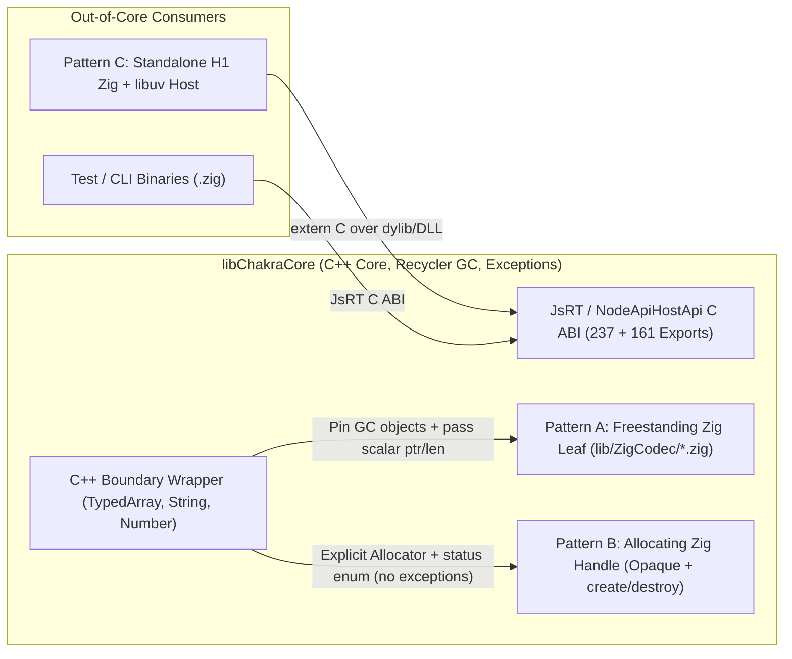

# Assessment: Converting ChakraCore Subsystems to Zig

> Status: Technical assessment on `modernize/baseline` (extending [zig-strategy.md](zig-strategy.md), [z1-u8a-codec.md](z1-u8a-codec.md), and [memory-management.md](memory-management.md)).

---

## 1. Executive Verdict & Context

ChakraCore already compiles every profile with Zig `0.17.0` ([build.zig](../build.zig), [linux.zig](../tools/build/linux.zig), [windows.zig](../tools/build/windows.zig)), and the `Z1` pilot ([u8a_codec.zig](../lib/ZigCodec/u8a_codec.zig), 954 LOC + [u8a_codec.h](../lib/ZigCodec/u8a_codec.h), 74 LOC) proved that freestanding Zig SIMD modules integrate cleanly into `libChakraCore` on macOS, Linux, and Windows with zero leaked exports (`zig_u8a_*`) and `7/7` unit tests wired into `zig build check-selftest`.

However, two major realities have shifted since the original November 2026 [zig-strategy.md](zig-strategy.md) note:

1. **`lib/NodeApi` is no longer a greenfield Zig candidate.** It now exists as `33` C++ files (`19,571` LOC, `20` `Recycler`-touching files) exposing `161` `NAPI_VERSION=10` exports over `JsRT`. Rewriting it in Zig today would trade an already working ABI layer for pure churn and FFI risk.
2. **Real-world Zig integration and hardening surfaced clear boundaries:**
   - **Where Zig excels:** Stateless leaf codecs/parsers (`u8a_codec`), numeric parsing (`strtod`), and out-of-core hosts/tools (`H1`) gain bounds-checked slices, trapped UB in safe modes (`ToUInt8Clamped(NaN)`-class casts), `errdefer` resource discipline, and zero C++ `#include`/template-instantiation headaches (`RV-04c`, `RV-04d`, Windows `JavascriptMath` PCH ordering).
   - **Where Zig does *not* solve the hard bugs:** Concurrent GC write-barrier UAFs (`RV-01`), C++/GC callback lifetime bugs, `MAP_JIT`/CFG invariants (`#505`), and ECMAScript spec/perf bugs (`RV-02`, `RV-03`, `RV-07`, `RV-09`) stem from runtime ownership and domain invariants that Zig's manual memory model does not check automatically.
   - **Operational costs:** Any Zig object inside `libChakraCore` requires `.sanitize_c`/`.debug` flag alignment and per-member sanitizer symbol verification (`RV-10` caught `u8a_codec.o` missing `-fsanitize` flags across an archive-wide check), plus pre-1.0 Zig `0.17.0` upgrade tax across all `.zig` sources.

**Bottom line:**
- **Worth it:** Pure leaf data/numeric modules under `lib/ZigCodec/` (especially replacing [NumberUtilities_strtod.cpp](../lib/Common/Common/NumberUtilities_strtod.cpp) and `lib/Common/Codex`), and a **new** standalone `H1` (`Zig + libuv`) host outside `libChakraCore`.
- **Conditional:** Selective `PlatformAgnostic`, `pal/src/map`, or split Wasm binary decode/validation -- only when driven by active bugs, security parsing needs, or new feature work.
- **Not worth it:** `lib/NodeApi` (done in C++), legacy `bin/ch` (keep as a test harness), and the `~550K-800K` LOC GC/exception-coupled engine core (`Parser`, `ByteCode`, `Memory`/`Recycler`, `Runtime`, `Backend`).

---

## 2. Measured Codebase Coupling Map

Measured directly on `modernize/baseline` (`files` counts `.cpp`/`.c`/`.h`/`.inl`/`.zig`; `recycler_files` counts files referencing `Recycler`, `RecyclableObject`, or `Field(`; `throws` counts C++ `throw ` sites).

| Area | Files | LOC | `Recycler` files | `throw` sites | Tier / Verdict |
|---|---:|---:|---:|---:|---|
| [u8a_codec.zig](../lib/ZigCodec/u8a_codec.zig) + [u8a_codec.h](../lib/ZigCodec/u8a_codec.h) | 2 | 1,028 | 0 | 0 | **Shipped template** (`Z1`) |
| `lib/Common/Common/NumberUtilities*` ([NumberUtilities_strtod.cpp](../lib/Common/Common/NumberUtilities_strtod.cpp) = 3,173 LOC) | 5 | 4,523 | 0 | -- | **Tier 1 (Worth It)** (`strtod` fixes `IH-5`) |
| `lib/Common/Codex` ([Utf8Codex.cpp](../lib/Common/Codex/Utf8Codex.cpp) + headers) | 3 | 1,483 | 0 | 0 | **Tier 1 (Worth It)** |
| [UriHelper.cpp](../lib/Runtime/Library/UriHelper.cpp) | 1 | 595 | -- | -- | **Tier 1 (Worth It)** |
| New `H1` standalone host (`Zig + libuv` over `JsRT` + [NodeApiHostApi.h](../lib/NodeApi/NodeApiHostApi.h)) | new | ~2-4K | 0 | 0 | **Tier 1 (Worth It)** for new product host |
| `lib/Common/PlatformAgnostic` + `lib/Runtime/PlatformAgnostic` | 38 | 4,499 | 0 | 0 | **Tier 2 (Selective)** |
| `pal/src/map` + `pal/src/misc` (within `pal/src/{map,file,thread,synchmgr,misc,exception,cruntime}` = 50 files / 48,926 LOC; ~105K total `pal/`) | 13 | 8,920 | 0 | 0 | **Tier 2 (Conditional)** (`map`/`misc` only) |
| `lib/WasmReader` (`31` / `6,579` / `7` Recycler) & `lib/wabt` (`54` / `8,200` / `5` Recycler / `29` throws) | 85 | 14,779 | 12 | 29+ | **Tier 2 (Conditional)** (decode/validate leaf only) |
| `bin/ch` (`23` / `8,656`), `bin/NativeTests` (`19` / `5,004`), `tools/nodeapi` (`7` / `2,719`), `bin/GCStress` (`8` / `1,463`) | 57 | 17,842 | 10 | 21+ | **Keep C++ harness**; write *new* CLI tools in Zig |
| `lib/NodeApi` | 33 | 19,571 | 20 | -- | **Tier 3 (No)** -- already shipped in C++ (161 exports) |
| `lib/Runtime/ByteCode` | 57 | 43,970 | 11 | -- | **Tier 3 (No)** |
| `lib/Parser` | 83 | 66,766 | 17 | -- | **Tier 3 (No)** |
| `lib/Common/Memory` | 119 | 58,134 | 84 | -- | **Tier 3 (Never)** |
| `lib/Runtime/Language` | 152 | 83,857 | 65 | -- | **Tier 3 (Never)** |
| `lib/Runtime/Library` (whole subsystem) | 265 | 172,447 | 216 | -- | **Tier 3 (Never)** (extract pure codecs only) |
| `lib/Backend` | 253 | 244,962 | 56 | -- | **Tier 3 (Never)** |

*(Also measured: `lib/Common/Util` 46 LOC / 0 Recycler; `lib/Common/DataStructures` 17,201 LOC / 22 Recycler; `lib/Common/Core` 12,083 LOC / 16 Recycler; `lib/Runtime/Math` 2,879 LOC / 2 Recycler; `lib/SCACore` 2,827 LOC / 7 Recycler / 2 throws.)*

---

## 3. Candidate-by-Candidate Evaluation

### Tier 1 -- Worth Converting (High ROI, Clean Leaf Boundaries)

1. **`NumberUtilities_strtod.cpp` ([NumberUtilities_strtod.cpp](../lib/Common/Common/NumberUtilities_strtod.cpp), 3,173 LOC)**
   - **Why convert:** `strtod` is a pure numeric parser (input ASCII slice + radix/options -> `double` + status). `NumberUtilities_strtod.cpp` currently hardcodes a 20-digit decimal buffer limit (`kcchMaxSig = 20`), which directly causes the confirmed `IH-5` subnormal rounding bug noted in `review-glm.md` (`5e-324` vs `1e-323`).
   - **Why Zig helps:** A Zig module using Eisel-Lemire + exact multi-precision fallback (or `std.fmt.parseFloat`-style exact arithmetic over explicit `(ptr, len)` inputs) eliminates overflow/truncation bugs, deletes ~3K LOC of legacy C++, has zero `Recycler`/exception coupling, and can be exhaustively unit-tested with `zig test` inside `check-selftest`.

2. **`lib/Common/Codex` ([Utf8Codex.cpp](../lib/Common/Codex/Utf8Codex.cpp) + headers, 1,483 LOC, 0 Recycler, 0 throws)**
   - **Why convert:** Pure UTF-8 / WTF-8 / CESU-8 / UTF-16 transcoding and validation on caller-owned buffers on hot paths (source loading, `JSON`, `TextEncoder`/`TextDecoder`, JsRT string conversions, Node-API UTF-8 marshaling).
   - **Why Zig helps:** Directly mirrors `u8a_codec.zig`'s `@Vector(16, u8)` SIMD design, removes pointer-arithmetic off-by-one/surrogate-pair hazards via slice bounds checking, and plugs in behind existing leaf C signatures.

3. **[UriHelper.cpp](../lib/Runtime/Library/UriHelper.cpp) (595 LOC) & Future Pure Built-in Codecs (`lib/ZigCodec/`)**
   - **Why convert:** `encodeURI`/`decodeURI` and pure byte/string codecs (e.g., future `JSON` SIMD whitespace/string scanning or compression/hash utilities) operate on validated input slices into fixed-capacity or length-precomputed buffers. Extracting only the byte-crunching leaf functions out of `lib/Runtime/Library/` keeps JS object/exception handling in C++ while eliminating manual pointer loops.

4. **`H1` Standalone Host (`Zig + libuv` over `JsRT` + [NodeApiHostApi.h](../lib/NodeApi/NodeApiHostApi.h)) -- *New code, not a rewrite of `bin/ch`***
   - **Why invest here instead of rewriting `bin/ch` (`8,656` LOC):** `bin/ch` is tightly bound to ChakraCore's `WScript` regression/RL test harness. As planned in [zig-strategy.md](zig-strategy.md), building a new general-purpose embedder/CLI host in Zig over public `JsRT` (`237` C exports) and `NodeApiHostApi.h` avoids rewriting test-only host glue while showcasing Zig's sweet spot: explicit allocators, `errdefer` handle cleanup (preventing `RV-15`/`#550`-style teardown leaks), `std.testing.checkAllAllocationFailures`, and clean C-ABI consumption of `libChakraCore` + `libChakraNodeApi`.

### Tier 2 -- Conditional (Convert Only With a Clear Trigger)

5. **`lib/Runtime/PlatformAgnostic` (`3,885` LOC, 0 Recycler) & `pal/src/map` (`5,828` LOC, 0 Recycler)**
   - **Case for:** Platform bugs cluster around OS syscalls, `mmap`/`VirtualAlloc`, and Apple Silicon `MAP_JIT` / `pthread_jit_write_protect_np` state machines (`#505`). Zig's standard OS bindings, exhaustive `switch` on platform error codes, and `errdefer` unmap rollback make virtual-memory and OS-wrapper logic clearer than macro-heavy C++.
   - **Case against doing it right now:** `pal/src/map` is already `5,828` LOC and tightly cross-coupled to PAL handle tables and JIT executable-page accounting; converting it piecemeal requires hand-writing C shims between C++ PAL headers and Zig, and `pal/src/exception` (`3,485` LOC) / `pal/src/synchmgr` (`6,931` LOC) / `pal/src/thread` (`8,307` LOC) depend directly on C++ stack unwinding, signals, SEH, and futex internals where Zig buys little and increases ABI surface risk.
   - **Verdict:** Only convert small self-contained PlatformAgnostic utilities (or a clean OS virtual-memory/codec leaf) when an active maintenance need justifies the shim.

6. **`lib/WasmReader` (`6,579` LOC, 7 Recycler) & `lib/wabt` (`8,200` LOC, 5 Recycler, 29 throws)**
   - **Case for:** Decoding/validating untrusted WebAssembly byte streams is classic parser-security territory where slice bounds checks and overflow-trapping integer arithmetic eliminate whole classes of OOB reads and integer overflows.
   - **Case against right now:** Both currently allocate IR/module metadata straight into `Recycler` and throw C++ parser/validation exceptions (`29` throws in `lib/wabt`). Converting Wasm decoding to Zig only makes sense if refactored into a two-phase boundary: `(1)` stateless Zig binary validator/decoder writing into caller-owned/arena native structs, `(2)` C++ builder lowering validated IR into `Recycler`/`FunctionBody`. Worth doing *only* if investing heavily in new Wasm proposals or hardening Wasm fuzzing.

7. **New Native Diagnostics & Regression Tools (e.g., future `bin/NativeTests` / `tools/` harnesses)**
   - Writing *new* CLI/host harnesses in Zig is clean (`check_metadata` / `check_regression` / `pal-config` / `gate-tests` already prove this), whereas rewriting working C++ harnesses like `bin/GCStress` (`9` `Recycler` couplings) or existing `bin/NativeTests` gives low ROI.

### Tier 3 -- Not Worth Converting (Active Harm or Zero ROI)

8. **`lib/NodeApi` (`33` files, `19,571` LOC, `20` `Recycler` files)**
   - Already implemented and verified in C++ at `161` `NAPI_VERSION=10` exports (`19/19` Node-API probes). Rewriting it in Zig adds zero capability, loses RAII exception barriers around internal/JsRT boundary code, and risks regressing delicate reference/handle-scope/finalizer edge cases (`#550`, `RV-04d`).

9. **Core Engine: `Parser` (66.8K), `Runtime/ByteCode` (44K), `Common/Memory` (58.1K), `Runtime/Language` (83.9K), `Runtime/Library` core (172.4K), `Backend` (245K)**
   - **Total coupled core:** ~670K+ LOC (with `56` `Recycler`-coupled files even inside `lib/Backend` and `216` inside `lib/Runtime/Library`).
   - **Why Zig cannot solve the core's hardest memory bugs -- and would worsen risk:**
     - **Write-barrier guarantees:** As `RV-01` (`DList<AsyncGeneratorRequest*, Recycler>`) proved, concurrent mark-sweep requires every pointer store in traced memory to hit `Field<T>`/`WriteBarrierPtr<T>`. C++ enforces this at assignment via operator overloading; Zig cannot import C++ templates (`@cImport` is C-only) and has no compiler-enforced GC write-barrier pass.
     - **Conservative stack scanning & frame layout:** `Recycler`, debugger inspection, and TTD rely on C++ ABI/frame conventions and `ENTER_PINNED_SCOPE`.
     - **Exceptions as control flow:** `646+` C++ `throw` sites implement OOM, parser early errors, JIT bailout/abort (`OperationAbortedException`), and `TryCatch`/`TryFinally`. Exceptions cannot unwind through `callconv(.c)` Zig frames without trapping or rewriting the entire runtime onto manual status returns.
     - **Pre-1.0 churn:** Maintaining hundreds of thousands of lines across Zig `0.17.0 -> 0.18+` breaking stdlib/build updates adds permanent tax with zero borrow-checker benefit (Zig is still manual memory management -- UAFs and double-frees remain possible).

---

## 4. How Integration Into the Pre-Existing App Works

Any Zig addition must follow one of three bounded architectural patterns -- matching [zig-strategy.md](zig-strategy.md), [z1-u8a-codec.md](z1-u8a-codec.md), and [owned-bytes.zig](examples/owned-bytes.zig):

### Three Integration Patterns

- **Pattern A -- Freestanding Leaf Object inside `libChakraCore` (Preferred, proven by [u8a_codec.zig](../lib/ZigCodec/u8a_codec.zig)):**
  - `.link_libc = false`, `.link_libcpp = false`, `0` heap allocations inside Zig, `0` syscalls, `0` global state.
  - All buffers are allocated and owned by C++ (`Recycler`/`BufferStringBuilder`/stack scratch) and passed as raw `(ptr, len)` scalar pairs + out-lengths + `u8`/enum status codes.
  - Ideal for `strtod`, UTF-8/16 `Codex`, `URI` codec, and Wasm binary validation.

- **Pattern B -- Allocating C-ABI Handle Module inside `libChakraCore` or PAL (Template: [owned-bytes.zig](examples/owned-bytes.zig)):**
  - Used only when Zig *must* retain dynamic memory or OS handles across calls.
  - Exports opaque `*Handle` plus paired module `create`/`destroy` functions; Zig captures its own explicit `std.mem.Allocator` inside the struct, rolls back every partial step via `errdefer`, and exposes `.view()` without transferring free authority.
  - C++ callers must never `free`/`HeapDelete` a Zig pointer, and foreign `JsErrorCode` failures must be translated into Zig `!T` errors before returning so `errdefer` executes.

- **Pattern C -- Out-of-Core Consumer (`H1` Standalone Host, Separate Repo):**
  - Lives in a **separate downstream repository** consuming ChakraCore's `zig build package` artifact (with a local `-Dchakracore-prefix=` / sibling checkout override for lockstep engine iteration) rather than inside `ChakraCore`, linking against `libChakraCore` + `libChakraNodeApi` strictly through `ChakraCore.h` (`JsRT`) and [NodeApiHostApi.h](../lib/NodeApi/NodeApiHostApi.h).
  - Cross-thread/GC lifetimes obey `JsAddRef`/`JsRelease` and `NodeApiHostApi` runtime rules without seeing C++ headers.

### Concrete Build, Safety & Verification Checklist (6 Required Steps)

Based directly on [build.zig](../build.zig), [linux.zig](../tools/build/linux.zig), [windows.zig](../tools/build/windows.zig), and lesson `RV-10`:

1. **Flat `extern "C"` Header Contract (`lib/ZigCodec/<name>.h`):**
   - Only fixed-width C types (`uint8_t`, `uint16_t`, `size_t`, `double`), `enum` status codes, and caller-owned `(ptr, len)` parameters cross the ABI. Never expose Zig slices, error unions, C++ classes, or exceptions across the boundary.
   - Explicitly document empty-buffer rules (`len == 0` with `ptr == nullptr`, as occurs for `ArrayBuffer(0)`).

2. **Compile Across All Three Zig Build Graphs with Sanitizer & Debug Flag Parity:**
   - Wire `b.addObject(...)` into all three platform builders (`build.zig`, `tools/build/linux.zig`, `tools/build/windows.zig`) using `.pic = true`, profile-matched `.optimize`, **and** `.sanitize_c` + `.debug` matching the active engine profile (`RV-10`: leaving `u8a_codec_obj` unsanitized when the engine builds with ASan/UBSan causes missing sanitizer metadata checks).

3. **Hidden Symbol Visibility & Linker Hygiene:**
   - Every C export in Zig uses `callconv(.c)` and `@export(&fn_name, .{ .name = "zig_...", .linkage = .strong, .visibility = .hidden })`.
   - Zero internal `zig_*` symbols may appear in `libChakraCore.dylib` / `.so` / `.dll` public exports (verified by export-set gates in [check_metadata.py](../tools/build/check_metadata.py) / [check_metadata_linux.py](../tools/build/check_metadata_linux.py)).

4. **Static Archive, Metadata & Self-Test Gate Wiring:**
   - Append the emitted `.o`/`.obj` into `libChakraCoreStatic` / `ChakraCore.dll` *outside* the C/C++ TU contract assertions (`expect_total` in `build.zig`, `expectedCompileCount` in `linux.zig`), update per-profile archive member pins, ensure per-member sanitizer symbol verification checks the Zig object cleanly, and add `b.addRunArtifact(b.addTest(...))` to `zig build check-selftest`.
   - For Pattern B modules, include `std.testing.checkAllAllocationFailures(std.testing.allocator, ...)` tests inside `check-selftest`.

5. **Reentrancy & GC Pinning Protocol ([memory-management.md](memory-management.md) Sections 2-6):**
   - Execute *all* JS coercions, `valueOf`/getter calls, option parsing, and detachment/bounds checks on the C++ side **before** borrowing pointers.
   - Hold live JS owners (`JavascriptString*`, `ArrayBuffer*`, `TypedArrayBase*`) inside `ENTER_PINNED_SCOPE` across any allocation, then enter Zig strictly inside a non-reentrant leaf window (Zig cannot allocate `Recycler` memory or call back into JS).
   - Write the compact Section 3 Ownership Record (allocator, bounds, invalidation triggers, failure cleanup) before landing.

6. **Parity Flag + Delete-the-Old Discipline:**
   - Run the new Zig implementation alongside the full regression suite, Test262 differential tests, ASan + UBSan (`halt_on_error=1`), and perf-smoke checks; once green on all platforms, delete the replaced C++ implementation rather than maintaining two versions indefinitely.

---

## 5. Decision Matrix & Practical Recommendation

| Candidate | Safety Benefit | Perf Benefit | Integration Risk | Zig Upgrade Tax | Worth Doing? |
|---|---|---|---|---|---|
| **[NumberUtilities_strtod.cpp](../lib/Common/Common/NumberUtilities_strtod.cpp)** (`3,173` LOC) | High (fixes `IH-5`, removes manual bigint buffer bugs) | Moderate-High (Eisel-Lemire fast-path) | **Very Low** (Pattern A pure C ABI) | Low | **Yes -- Best #1 conversion** |
| **`lib/Common/Codex`** (`1,483` LOC) | High (bounds-checked UTF-8/16/CESU-8 SIMD) | High (SIMD ASCII/UTF-8 scan) | **Low** (Pattern A pure leaf buffers) | Low | **Yes -- Strong #2 conversion** |
| **New `H1` Standalone Host** (`Zig + libuv`) | High (`errdefer` native/handle hygiene) | Low-Mod (fast startup/I/O) | **Very Low** (`JsRT` public ABI only) | Low-Med | **Yes -- Best new-surface investment** |
| **[UriHelper.cpp](../lib/Runtime/Library/UriHelper.cpp) (`595` LOC) / new ES codecs** | Moderate (eliminates raw pointer loops) | Moderate | **Very Low** (Pattern A) | Very Low | **Yes -- Opportunistically** |
| **`PlatformAgnostic` / `pal/src/map`** (`~10K` LOC) | Moderate (cleaner OS error/unmap handling) | Neutral | **Medium** (C++ PAL shim & TLS/locks) | Medium | **Conditional** -- only per isolated pain point |
| **`lib/WasmReader` + `lib/wabt`** (`~14.8K` LOC) | High *for parser/validator* (slice safety) | Neutral | **Med-High** (must decouple `Recycler` IR + `29` throws) | Medium | **Conditional** -- only for new Wasm investment |
| **`lib/NodeApi`** (`19.6K` LOC) | Neutral/Negative (already complete in C++) | None | **High** (161-export ABI/lifecycle churn) | Med-High | **No -- Do not rewrite** |
| **`pal/src/{exception,synchmgr,thread}`** (`~18.7K` LOC) | Low/Negative (signal/unwind ABI sensitivity) | None | **High** | Med-High | **No** |
| **Core Engine** (`Parser`/`ByteCode`/`Memory`/`Runtime`/`Backend`) | **Negative** (loses `Field<T>` write barriers & RAII unwind) | Negative (FFI overhead across VM boundaries) | **Extreme** (multi-year rewrite, ~670K+ LOC) | Extreme | **No -- Never** |

### Recommended Next Sequence (If Investing in Zig Conversions)

1. **Immediate High-ROI Pair (`Pattern A`, tiny blast radius):**
   - Port `strtod` (`NumberUtilities_strtod.cpp` -> `lib/ZigCodec/strtod.zig`) to fix `IH-5` cleanly and retire `3.1K` lines of brittle legacy C++.
   - Port `lib/Common/Codex` UTF-8/UTF-16 codecs (`lib/ZigCodec/utf8_codec.zig`) for SIMD speed and bounds safety across runtime/JSON/JsRT/Node-API string conversions.
2. **Product Surface Expansion (`Pattern C`, zero engine coupling):**
   - Build the standalone `H1` (`Zig + libuv`) host consuming `JsRT` + `NodeApiHostApi.h`, leaving `bin/ch` untouched as the WScript regression runner.
3. **Toolchain Checkpoint Before Any Tier 2 Work:**
   - Survive at least one pinned Zig upgrade (`0.17.0` -> `0.18.x`) across `build.zig` + `lib/ZigCodec/` first to measure real pre-1.0 upgrade cost before expanding Zig into larger `PlatformAgnostic` or Wasm decoding layers.
